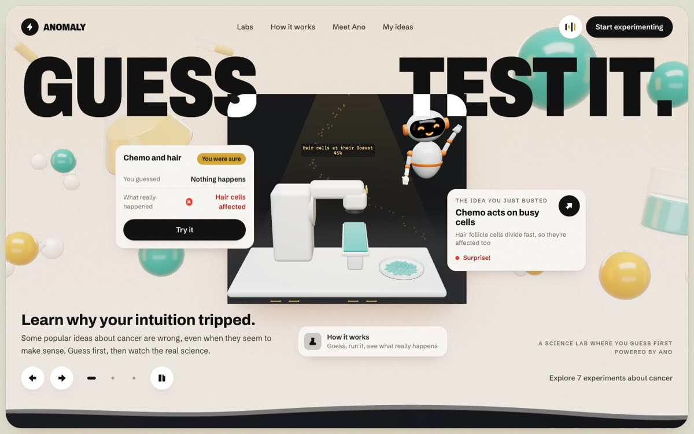
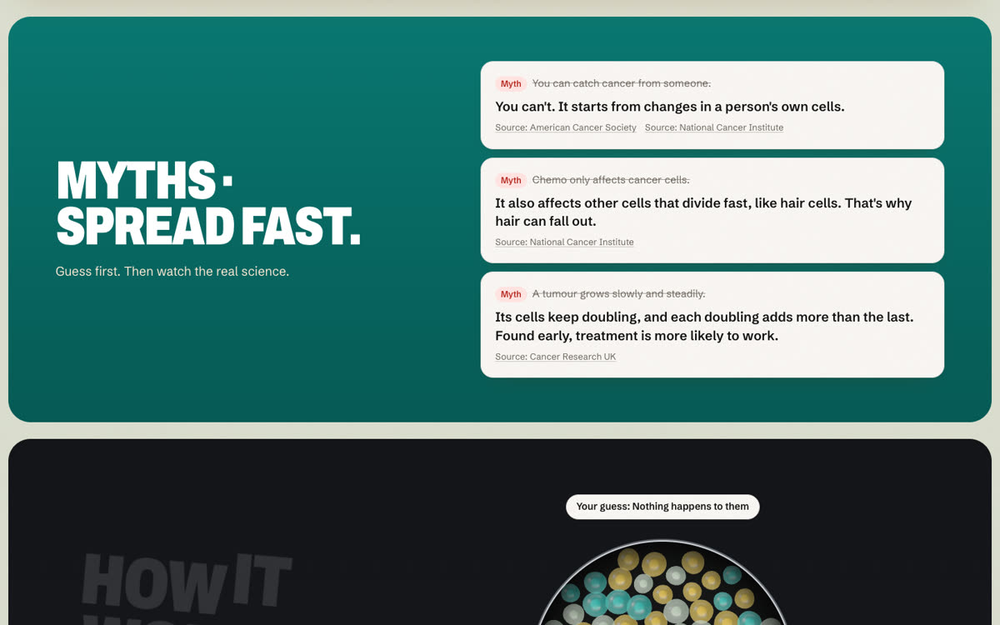
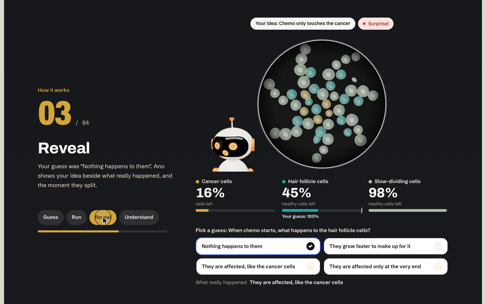
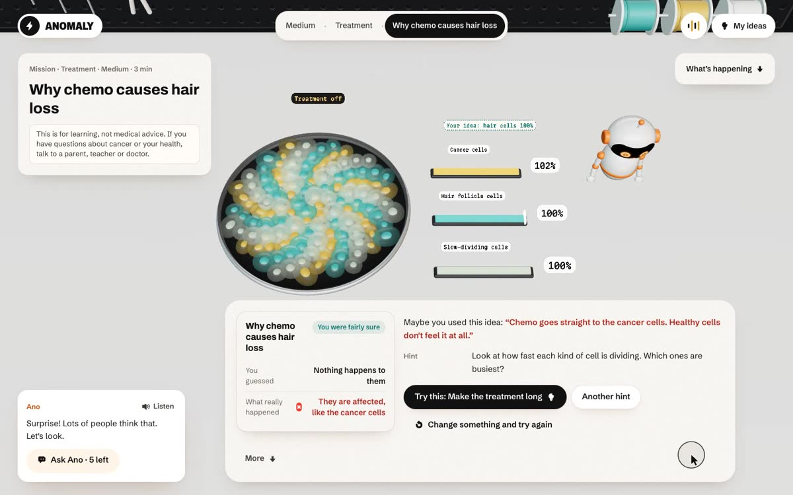
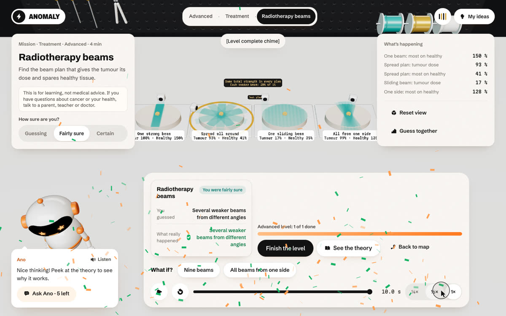
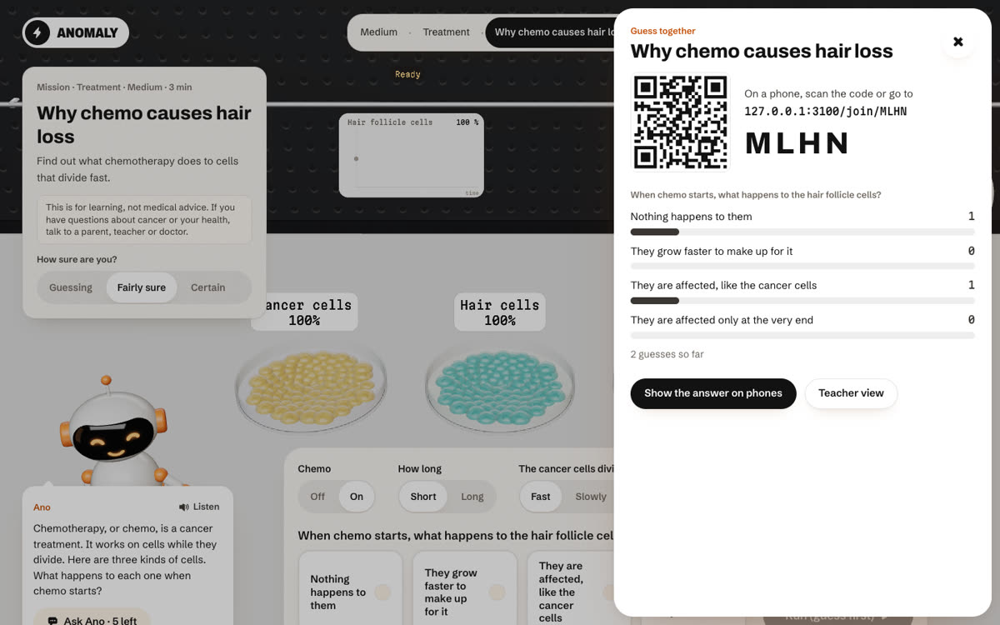

<div align="center">

# ANOMALY

### Guess. Test it. See exactly where your thinking broke.

**A free cancer science lab for students aged 11 to 18, right in the browser.**

[Live demo: add the Vercel link here] · Built for **CodeTheCure** (Education)

<br />



</div>

<br />

> In biology, cancer begins as an anomaly: one cell that stops following the body's rules.
> ANOMALY is also the feeling when reality contradicts your guess. That feeling is where learning starts.

<br />

## The problem

Most of what young people believe about cancer comes from rumours, films and half-heard conversations. *You can catch it. Chemo only touches the cancer. Clouds block the sun's UV.* Those beliefs make cancer scarier than it needs to be, delay checkups, and confuse families during treatment. A poster rarely changes them, because a belief that feels right survives being told it's wrong. It only breaks when you watch it fail with your own eyes.



<br />

## How it works

| 1 · Guess | 2 · Run | 3 · Reveal | 4 · Understand |
|---|---|---|---|
| Commit to a prediction, and say how sure you are. | Watch a real simulation under the microscope, with slow motion, pause and rewind. | Wrong? Your guess appears as a ghost beside reality, and the replay stops at the exact moment they split. | A three-step hint ladder, then the theory: what happened, why, and the sources. |



<br />

## The ANOMALY moment

The simulator is the judge, never an AI. When your guess and reality disagree, Ano, a friendly robot guide, names the idea you probably used, asks one guiding question, and lets you change one thing and try again.



<br />

## Seven experiments, four labs, one story

| Lab | Experiment | The wrong idea it breaks | Level |
|---|---|---|---|
| **Cell Lab** | Cells out of control | Normal cells never stop dividing | Easy |
| | Can you catch cancer? | Cancer is something you catch | Easy |
| | Born with it? | Cancer is mostly passed down in families | Medium |
| **Prevention Lab** | UV on a cloudy day | Clouds block the sun's UV | Easy |
| **Detection Lab** | How tumours grow | Tumours grow at a steady speed | Easy |
| **Treatment Lab** | Why chemo causes hair loss | Chemo only attacks cancer cells | Medium |
| | Radiotherapy beams | One strong beam is best | Advanced |



<br />

## Guess with the room

Press **Guess together** on any experiment. A 4-letter code and a QR code appear, phones tap a guess, live bars show the split, and one tap reveals what the simulator says to every phone. The teacher view shows the class results and the most common wrong idea in plain words. Real counts only, no names, nothing stored about anyone.



<br />

## Every fact checked

- **41 claims**, each confirmed on the World Health Organization, the National Cancer Institute, Cancer Research UK or the American Cancer Society, recorded with the exact quote and URL in `content/citations.json`. A missing citation fails the build.
- **23 validation checks** run the teaching models against those claims, live on `/science`.
- **Gentle by design.** A test scans every line a student reads for scary words, survival talk, emojis and long sentences. Every lab page carries the learning note, and Ano warmly sends any question about someone's own health to a parent, teacher or doctor.

> This is for learning, not medical advice. If you have questions about cancer or your health, talk to a parent, teacher or doctor.

<br />

## Built with

**Next.js 16** (App Router) · **React 19** · **TypeScript** · **Tailwind CSS 4** · **three.js** with React Three Fiber and drei (one shared canvas) · **GSAP** and **Lenis** · **zustand** · **zod** · **Vercel AI SDK** (Groq) · **ElevenLabs** · **Upstash Redis** · **Vitest** and **Playwright**

- Deterministic teaching models in `engine/` (pure TypeScript), with a wrong model for every misconception, so the simulator can tell *which* idea you used.
- 60 fps on the production build, on High and on the Low tier with the CPU slowed 4 times.
- No accounts and no personal data. Progress stays in your browser.

<br />

## Run it locally

Needs Node 20 or newer.

```bash
npm install
npm run build
npm start            # http://localhost:3000
```

`npm run dev` starts the development server. `npm run test` runs the unit tests and `npx playwright test` the end-to-end suite on the production build.

**Keys are optional.** Without them, Ask Ano answers with written hints, Ano speaks with the browser's own voice, and live class rooms run in the server's memory. Each provider does one job:

| Job | Provider | Environment variables |
|---|---|---|
| Ask Ano and Explain it simpler | Groq | `GROQ_API_KEY`, `GROQ_MODEL` |
| Ano's voice | ElevenLabs | `ELEVENLABS_API_KEY`, `ELEVENLABS_VOICE_ID`, `ELEVENLABS_MODEL` |
| Rate limits, cache, impact counter, live rooms | Upstash Redis | `UPSTASH_REDIS_REST_URL`, `UPSTASH_REDIS_REST_TOKEN` |
| Grading the Ask Ano eval (tests only) | Google Gemini | `GOOGLE_GENERATIVE_AI_API_KEY`, `GEMINI_MODEL` |

On Vercel, set the Node.js version to 24.x in Project Settings and add the same variables. Never commit `.env.local`.

<br />

## Credits and licences

ANOMALY is MIT licensed.

- **Cancer facts:** World Health Organization, National Cancer Institute (cancer.gov), Cancer Research UK and the American Cancer Society. Every page used is listed on `/science`.
- **3D:** every model is built in code for this project: the cells, microscope fields, scanner, UV meter, treatment machine, body slices and Ano.
- **Fonts:** Archivo, Schibsted Grotesk and Martian Mono (SIL Open Font License 1.1).
- **Icons:** our own set, drawn for ANOMALY.
- **UI patterns:** a few interactions were studied on Aceternity UI, Skiper UI and Animmaster Lib and rebuilt from scratch; no code was copied.
- **Libraries:** three.js, React Three Fiber, drei, Rapier, Lenis, maath, zustand, zod, motion, qrcode (MIT); postprocessing (Zlib); Vercel AI SDK (Apache-2.0); idb (ISC); GSAP and ScrollTrigger (GSAP standard licence).

<br />

<div align="center">

**Guess first. Then watch the real science.**

</div>
